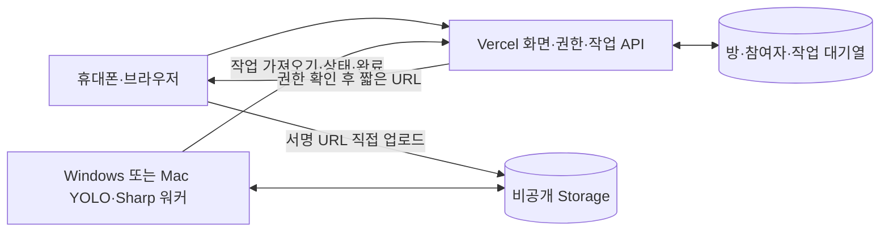

# 사진 병합 서비스 요구사항

## 기능 선택 홈과 보정 UI 개편 — 2026-11-06

- `/`는 MOIRA 스플래시 뒤 `함께 보정`과 `사진 합치기` 두 개의 큰 선택 카드를 보여준다. 각각 `/retouch`, `/sessions/new`로 연결한다. 스플래시는 홈에서 한 번 보여주며 기능 진입·초대 링크에서 반복하지 않는다.
- 홈·retouch·사진 합치기 UI를 Figma 기준으로 구현한다. 기존 방·편집·합성·저장 계약을 재사용한다.
- 디자인 기준은 [Figma 04 · 스타일 비교](https://www.figma.com/design/RuyZOuRcQIN6M5RYjR6vJE?node-id=505-2016)와 사용자가 제시한 두 카드 진입 구조다. 작업 기본값은 파스텔·창 구성과 또렷한 테두리의 조합이며, 실제 Figma의 글꼴·색·간격·아이콘을 재사용한다. A/B 두 테마나 테마 전환 기능은 만들지 않는다. 휴대폰 상태 표시줄·브라우저 주소창은 앱 UI에 포함하지 않는다.
- retouch는 진입·방 생성·참여 현황·얼굴/터치 보정·결과 화면에 같은 스타일을 적용한다. 기존 독립 보정도 유지하고, 기존 중간 상태·오류·저장 동작을 새 UI에 연결한다. Next.js·React·CSS Modules를 유지하고 필요한 최소 UI만 재사용한다.

- 공동 보정방 생성 화면은 상시 파일 제한·보관 안내와 별도 동의 체크박스를 표시하지 않는다. 이름과 유효한 사진으로 생성하며, 파일 제한은 검증 실패 시 안내한다. 서버는 동의 필드를 요구하거나 클라이언트가 동의를 자동 제출하지 않는다.

## 두 기능 분리와 공동 보정 진입 — 2026-11-05

- 기능 1은 기존 PicSync의 외부 보정본 업로드·영역 제출·병합이다. `/sessions/new`, `/sessions/{inviteToken}`의 초대·자동 검출·병합 규칙은 유지한다. 홈·스플래시 진입은 위 2026-11-06 규칙을 따른다. 기존 방을 공동 보정방으로 전환하지 않는다.
- 기능 2는 같은 방에서 각자 보정하는 서비스다. `/retouch`에 공동 보정방 진입을 연결하고 `/retouch/rooms/new`에서 생성, `/retouch/rooms/{inviteToken}`에서 참여·편집·결과 저장을 진행한다. 기존 독립 보정기의 사진 열기·편집·저장도 유지한다.
- 아래 협업 보정방 규칙과 연결된 Notion 통합본2를 새 공동 보정방에도 적용한다. 기존 협업 구현·인증·저장·워커를 재사용하되 공동 보정은 해당 경로에서 명시적으로 만든 방에만 활성화한다. 신규 공동 보정방의 인식은 대표자의 시작 시점에 접수한다. 병합 방의 원본 등록 시 자동 검출은 유지한다.
- 공동 보정 초대·새 방 링크는 `/retouch/rooms` 안에서 이어진다. 기존 실험 협업 주소는 호환성을 유지한다. 병합 방 주소를 공동 보정 주소로 바꾸거나 반대 흐름으로 자동 전환하지 않는다.
- 공동 경로의 참여는 `POST /api/retouch/rooms/{inviteToken}/participants`를 사용한다. 기존 참여 요청·응답 형식은 유지하되 서버가 공동 보정방 여부를 먼저 확인한다. 일반 병합방이면 `404 / RETOUCH_ROOM_REQUIRED`로 거절하고 참여자·참여 쿠키를 생성하지 않는다. 공동 방의 인식 시작 후 입장 제한과 만료 검사는 기존 규칙을 따른다. 일반 병합 참여 API는 유지한다.
- 이번 범위는 방·참여자 관리, 개인 협업 보정, 전체 사진·최종 확정의 연결과 각 단계 검증이다. 보정 엔진 재개발·새 기능·별도 서버·실시간 통신 구조 교체는 포함하지 않는다. 공통 기반의 수정이 꼭 필요하면 메인이 최소 변경하고 기존 병합 회귀 검사를 함께 수행한다.

## 진입 경로와 기능 분리 — 2026-11-03

- `/sessions/new`, `/sessions/{inviteToken}`은 원래 사진 병합 흐름이다. 홈의 사진 합치기로 진입하며 같은 원본을 각자 외부에서 보정하고, 보정본·영역을 제출하면 병합한다. 새 방도 이 흐름으로 만들며 원본 등록 시 검출 작업을 자동 접수한다.
- `/retouch`는 독립 브라우저 보정기다. 주소 뒤에 `/retouch`를 붙여 사진을 열고 보정·PNG 저장을 한다. 방 생성·참여·서버 저장을 요구하지 않는다. 병합 업로드에 보정기의 GPU·해상도 제한을 적용하지 않는다.
- 협업 보정 구현과 기존 데이터는 보존하되 기본 병합 흐름에 자동 연결하지 않는다. 기존 실험 방은 `/sessions/{inviteToken}/collaboration`에서 열고 공유한다. 일반 병합 방을 자동으로 협업방으로 전환하지 않는다. 새 협업방 생성 UI의 후속 범위는 위 2026-11-05 규칙을 따른다.

## 협업 보정방 — 별도 경로에 보존

[Notion 통합본2](https://app.notion.com/p/3f74aab6d6c8809bbab3c3be06395287)를 바탕으로 구현한 협업방의 아래 규칙은 명시적으로 협업이 활성화된 방에 적용한다. 일반 병합 방과 방 밖의 독립 보정에는 적용하지 않는다.

- 방 생성부터 24시간 유지한다. 대표자가 입장 대기에서 인식을 시작할 때 참여자 명단을 고정하고 신규 입장을 막는다. 각자 공통 검출 영역을 선택하고 앱 안에서 자신의 얼굴·터치를 보정한다.
- 선택은 서버 선점으로 확인하고 영역에 닉네임을 표시한다. 선택·개인 완료는 별도 상태다. 친구 캐릭터(참여자 ID에 고정된 캐릭터)·닉네임·완료 수를 편집 중에도 표시한다. 상태는 3초 간격과 화면 복귀 시 조회한다.
- 서버는 개인 편집 시작 시 선택 마스크와 선점한 검출 마스크의 교집합을 고정한다. 미리보기·PNG와 서버 저장은 이 영역 밖 원본 픽셀을 보존한다. 다른 사람의 영역을 손으로 확장해 가져갈 수 없다. 얼굴 기준점과 영역 연결은 원본 좌표로 판단한다.
- 개인 저장 성공 후 완료한다. 완료 취소·재진입은 제공하지 않는다. 전원 완료 후 대표자가 합성을 시작하면 개인 상태를 고정한다. 합성 실패는 같은 단계에서 재시도한다.
- 전체 사진 단계는 누구나 편집권을 요청할 수 있고 동시에 한 명만 편집한다. 얼굴 탭 없이 클래식·복원·원형 범위·확대/이동을 제공한다. 이번 터치의 기준은 편집 진입 시 최신 저장 결과다. 저장 성공 후 권한을 반환하며 다음 사람은 그 결과에서 시작한다.
- 전체 사진 편집권은 유지 요청과 만료 시각·일회성 토큰으로 관리한다. 연결 종료 후 만료된 편집의 늦은 저장을 거절한다. 저장 실패는 완료 처리하지 않고 편집권과 초안을 유지한다. 개인·전체 사진 미저장 뒤로 가기는 확인 후 이번 변경을 취소한다.
- 전체 사진 종료·건너뛰기는 대표자만 실행하며 다른 편집자가 있으면 막는다. 결과 확인 후 대표자만 최종 완료할 수 있다. 결과 확인부터 새 편집을 열지 않고 최종 완료 뒤 모든 편집·재제출을 UI·서버에서 차단한다. 참여자는 고정된 동일 최종 PNG를 저장한다.
- 원본, 개인별 얼굴 값·기준점·터치 기록, 개인 결과, 전체 사진의 기준 결과·순서·편집자·기록을 구분해 저장한다. 복원은 현재 편집에서 추가한 터치만 지우고 얼굴 보정·이전 저장 결과를 유지한다.
- 얼굴 30개 중 눈썹 앞머리는 앞부분의 좌우 간격만 변경하고 중간·꼬리·전체 각도는 유지한다. 코 크기·콧망울·코끝은 각 부위의 두 축을 같은 비율로 조절한다. 콧대·콧등의 적용 구간은 겹치지 않는다.
- 기기 다운로드는 원본 표시 해상도의 PNG, `moira-final.png`를 사용한다. 다운로드 실패 시 같은 확정본을 재시도할 수 있다. 원본 업로드 시 브라우저 보정 상한(20MB·1,600만 픽셀·8,192px)을 안내·검사한다.
- 실제 iPhone·Android 성능과 가림·작은 얼굴·단체 사진의 자연스러움은 자동 검사와 구분해 검증한다. 처리 불가/검출 실패 시 원본을 유지하고 안내·재시도를 제공한다. 자동 신원 추정·배경 생성은 하지 않는다.

## 목적

여러 사람이 같은 원본 사진을 각자 보정한 뒤, 마음에 드는 부분을 모아 한 장으로 합치는 서비스입니다. 원본 위에 선택한 부분을 색종이처럼 붙이며, 사진 전체를 다시 생성하지 않습니다.

CrowdSift와 분리된 사진 병합 전용 프로젝트입니다. 일반 방은 외부 앱에서 만든 보정본의 병합 흐름을 사용하고 `/retouch` 보정기는 독립적으로 엽니다. 외부 사진 API로 보정을 요청하지 않습니다.

## 사진 병합 사용자 흐름과 화면

PC에서는 중앙 402px, 휴대폰에서는 기기 너비 전체를 사용하는 모바일 웹입니다. Figma의 색상·글꼴·상단 진행 표시·하단 버튼을 따르며 기기의 상태 표시줄과 주소창은 재현하지 않습니다. 별도 앱 설치가 필요하지 않습니다.

1. 대표자가 이름과 원본 JPEG·PNG를 등록하고 공유 링크를 만듭니다.
2. 대표자는 초대 링크 공유 후 원본에서 자신의 ID를 여러 개 선택합니다. 참여자는 초대 수락 후 외부 앱에서 보정한 사진을 먼저 업로드한 다음 자신의 ID를 선택합니다. 화면의 원본 다운로드 버튼은 제공하지 않습니다. 원본 YOLO 결과를 방에 한 번 저장해 같은 ID를 공유합니다. ID는 사진 속 검출 영역의 번호이며 신원 인식이 아닙니다.
3. 필요하면 확대 화면에서 윤곽선 점을 드래그하거나 브러시·지우기로 수정합니다. 드래그는 브라우저에서 처리하고 상세 화면의 ‘완료’는 변경을 화면 초안에 확정합니다. 미완료 상태에서 상세 화면을 나가면 안내 후 상세 편집 전 초안으로 되돌립니다. ‘다음’ 또는 ‘제출’에서 원본 크기 흑백 마스크와 선택 ID를 서버에 저장합니다.
   - 점을 옮겨도 편집점 개수는 유지하며, 이동한 구간의 기존 경계가 조각으로 남지 않도록 교체합니다.
4. 대표자는 자신이 올렸던 원본을 외부 앱에서 보정하고 같은 크기의 보정본을 업로드합니다. 저장한 원본 영역을 업로드한 보정본에 적용해 자동 제출하며, 저장에 실패한 경우 업로드한 보정본으로 재시도합니다.
5. 참여자는 보정본 업로드 후 같은 좌표의 얼굴 영역을 확인·수정해 제출합니다. 원본 영역과 보정본 선택 저장이 모두 성공해야 제출 완료입니다. 자동 정렬·자동 얼굴 매칭은 하지 않습니다.
6. 비어 있지 않은 영역과 보정본을 제출한 참여자가 한 명 이상이면 대표자만 현재 결과를 병합할 수 있습니다. 미제출자의 과거 선택은 합성에서 제외하고 해당 얼굴은 원본 그대로 유지합니다. 나중에 제출하면 대표자가 최신 버전으로 다시 병합합니다.
7. 겹친 부분은 대표자가 기존 겹침 편집기로 사용할 보정본을 지정하고 다시 합칩니다. 모든 참여자는 결과를 확인하고 원본 크기 PNG를 내려받습니다.

보정본이 여러 장이면 썸네일로 고르고 각 보정본·마스크 쌍을 유지합니다. 제출 완료한 참여자의 저장된 쌍만 합성합니다. 원본 영역 재저장·새 보정본 업로드·빈 마스크 저장은 제출 완료를 해제하며, 다시 영역을 제출해야 합니다. 동일한 검출 ID는 먼저 선택한 참여자만 선택·저장할 수 있습니다. 수동 편집으로 생기는 픽셀 겹침은 기존 합성 흐름에서 확인합니다.

보정본 표시와 참여자 현황은 각 참여자가 처음 보정본을 업로드한 순서로 고정합니다. 같은 사람의 보정본은 그 안에서 업로드 순으로 묶고, 아직 업로드하지 않은 참여자는 뒤에 참여자 ID 순으로 표시합니다. 서버는 파일 저장 후 DB 등록 트랜잭션에서 보정본에만 방 안의 고유 `uploadOrder`를 부여합니다. 마스크 업로드·수정·재제출은 순서를 바꾸지 않습니다. 썸네일과 겹침 수정 목록의 이름은 참여자 ID로 연결한 닉네임을 사용하며, 첫 사진은 `진준영`, 추가 사진은 `진준영 2`처럼 표시합니다. 사진 선택은 파일 ID로 유지하며 주소의 `photo`·`overlapPhoto`로 새로고침 후에도 복원합니다. 복원은 현재 화면에서 접근 가능한 보정본으로 제한하고 공유 초대 링크에는 이 값을 포함하지 않습니다. 이 표시 순서는 합성의 겹침 우선순위와 별개입니다. 기존 보정본의 과거 업로드 순서는 복원할 수 없어, 전환 시 기존 파일 ID 조회 순서로 한 번 초기화합니다.

선택·보정 화면은 현재 참여 별명을 표시합니다. 사진 속 사람을 누르면 영역을 선택하고 다시 누르면 해제하며, 화면에는 ID 번호·선택 ID 목록·ID 버튼·첫 선택 바텀시트를 표시하지 않습니다. 내부 검출 ID와 저장 형식은 유지합니다. ‘영역 직접 다듬기’로 여는 어두운 상세 화면에는 화면 기준 작은 편집점과 간격을 둔 점선 윤곽을 표시하되 실제 마스크·윤곽 좌표는 변경하지 않습니다. 상세 화면을 완료 없이 닫거나 뒤로가면 수정 유실을 확인하고, 이탈 시 열기 전 초안을 복원합니다. 대표자의 원본 선택은 ‘다음’, 참여자의 보정본 선택은 ‘제출’로 저장합니다. 클릭은 서버에 검출 ID 선점을 기록하고 다시 클릭하면 본인의 선점을 해제합니다. 상세 화면의 ‘완료’는 마스크 초안만 확정합니다. 현황·결과 화면의 ‘추가 기능’ 메뉴는 숨기되 기능과 API는 유지하고, 결과 화면은 ‘사진 저장하기’ 아래 중앙에 ‘처음부터 다시 만들기’를 둡니다.

마스크 초안은 브라우저 안에서 유지하고 자동 서버 저장은 하지 않습니다. 검출 ID 선점은 클릭 시 서버에서 확정합니다. 미저장 이동에는 확인을 표시합니다. 단계는 별도 DB 상태 머신 없이 사진·원본 선택·제출·결과 데이터에서 판단합니다. 방 정보는 현황·초대 화면에서만 5초 간격으로 조회하고 화면 복귀 시 갱신합니다. 원본 분석 상태만 아래 규칙에 따라 별도로 조회합니다. 편집 중에는 선점 목록만 3초 간격과 화면 복귀 시 조회하며 마스크 초안을 다시 불러오지 않습니다. 편집 화면에서 명시적으로 저장할 때 방 버전 충돌(`SESSION_VERSION_CONFLICT`)만 최신 상태를 확인해 전체 저장 과정에서 최대 1회 자동 재시도합니다. 내 원본 선택·보정본 목록·저장 마스크·제출 상태가 달라졌으면 자동 재시도하지 않습니다. 참여자의 두 단계 저장 중 성공한 단계는 반복하지 않고 이미 업로드한 마스크를 재사용합니다. 영역 소유권·권한·만료·통신 오류는 자동 재시도하지 않으며, 반복 충돌은 초안을 유지하고 재시도를 안내합니다.

원본 검출은 **업로드 검증·원본 저장·방 등록이 성공한 뒤** 자동으로 접수합니다. 원본 등록과 분석 작업 생성은 같은 DB 트랜잭션입니다. 업로드 응답은 분석을 기다리지 않고 초대 화면으로 이동합니다. 브라우저 종료·앱 이동·Mac 일시 중지는 작업을 취소하지 않습니다. 실패해도 원본과 방은 보존합니다.

- `processing_jobs`에 `queued / running / ready / failed`를 저장합니다. 원본·보정본은 파일 ID, 합성은 방 ID·작업 버전으로 중복 접수를 막고 완료 결과를 재사용합니다.
- Mac 워커 하나가 Vercel API에서 대기 작업을 가져와 순서대로 YOLO 분석·Sharp 합성을 실행합니다. 공개 접속 포트·터널은 열지 않습니다. 할당은 120초, 유지 요청은 15초 간격이며 중단된 작업은 최대 3회 자동 처리 후 명시적 재시도를 제공합니다. YOLO는 120초, 전체 작업은 10분으로 제한합니다.
- 검출 결과의 기존 `DetectedRegions` 형식과 ID는 유지합니다. 큰 Base64 결과는 비공개 Storage JSON 한 개로 저장하고 DB에는 크기·ID·상자·파일 위치만 저장합니다. 기존 방의 최초 결과도 바이트와 ID를 보존해 전환합니다.
- 원본 분석 상태와 요청한 작업은 3초 간격으로 조회합니다. 원본 상태 조회는 화면이 숨겨지면 멈추고 복귀하면 확인합니다. 초대·이동을 막지 않으며, 편집 시작 후 늦게 도착한 결과로 초안을 바꾸지 않습니다. 실패 시 재시도·수동 선택을 제공합니다.
- 합성은 대표자·제출·현재 버전을 검사해 요청하고 결과 게시 시 다시 검사합니다. 처리 중 방 버전이 바뀌면 이전 결과를 최신으로 게시하지 않습니다. 만료되거나 할당을 잃은 워커의 완료도 거절합니다.

## 작은 윤곽 표시

- 기본 선택·상세 편집 화면은 단순화 전 원본 윤곽 면적을 기준으로, 가장 큰 외곽 면적의 0.5%와 4픽셀² 중 큰 값 미만인 조각·구멍의 선과 편집점을 숨깁니다. 가장 큰 외곽과 기준 이상인 구멍은 유지합니다. 기본 화면은 인물별, 상세 화면은 선택 마스크 전체를 기준으로 합니다.
- 숨긴 편집점은 점 드래그 대상에서 제외하지만 브러시·지우기는 원래 마스크 전체에 작동합니다. 드래그 중에는 표시 대상을 유지하고 완료 후 재판정하며, 확대·축소는 숨김 기준을 바꾸지 않습니다. 면적은 캐시하고 경계가 변경되면 갱신합니다.
- 이 규칙은 표시와 편집점 터치에만 적용합니다. 선택·충돌 강조의 채움, 마스크 픽셀·저장·합성, YOLO·GrabCut은 유지합니다.
- 기본 선택 화면의 색 윤곽선은 단순화 전 원본 윤곽을 따라 부드럽게 표시하되 각 점의 이동을 원본 기준 최대 8픽셀로 제한합니다. 상세 편집의 점선·편집점과 실제 마스크·저장·합성 영역은 바꾸지 않습니다. 계산한 표시선은 윤곽이 바뀔 때까지 재사용합니다.

## 1차 테스트 화면 수정

- `?`는 Figma의 화면별 제목·본문을 담은 390px 높이 하단 안내창을 엽니다. 아래에서 위로 올라오는 모션과 어두운 배경을 적용하고 ‘확인’·Escape·손잡이 클릭으로 닫습니다. 손잡이를 아래로 70px 이상 끌면 닫고, 짧게 끌면 제자리로 돌아옵니다. 동작 줄이기 설정에서는 모션을 생략합니다. 작은 화면에서는 안내창 내부를 스크롤하며 사진 합치는 중·최종 사진·참여자 제출 완료에서는 버튼을 숨깁니다.
- 초대 화면의 ‘사람 영역 분석 완료’, ‘초대 링크 공유하기’, 모든 원본 사진 저장 버튼·개인 복구 메뉴를 제거합니다. 링크 복사 안내는 하단에 2.5초 표시합니다. 초대 화면의 상단 뒤로가기는 새 방 생성 화면으로 이동하며 기존 방을 보존합니다. ‘처음부터 다시 하기’는 아래의 삭제 확인 흐름을 따릅니다. 화면 하단 버튼 영역의 구분선은 표시하지 않습니다.
- 업로드 상자 우측 상단의 원형 X 버튼은 브라우저의 파일·미리보기를 비우고 같은 파일도 다시 선택할 수 있게 합니다. 이미 등록된 원본은 변경하지 않습니다.
- 상세 편집은 Figma의 안내·점선·작은 편집점·하단 도구를 사용합니다. 수정 후 뒤로가면 ‘변경사항을 저장하지 않고 나갈까요?’ 팝업을 표시합니다. ‘나가기’는 상세 편집 전 초안을 복원하고 ‘계속 편집’은 현재 초안을 유지합니다. 상단·브라우저 뒤로가기에 동일하게 적용하며 변경이 없거나 완료한 경우에는 경고하지 않습니다.
- 검출 중에는 사진 위 로딩 모션을 표시합니다. 합성 중에는 ‘사진 합치기는 5분 정도 걸릴 수 있어요. 이용자가 많으면 더 지연될 수 있어요.’를 안내하고, 시작 30초 뒤 제목을 ‘평소보다 오래 걸리고 있어요’로 바꿉니다. 접수는 계속하며 이 안내는 작업 제한 시간을 변경하지 않습니다.
- `GET /api/sessions/{inviteToken}/region-claims`는 `{claims:[{regionId,participantId,nickname}]}`를 반환하고 `PUT`은 `{regionId,selected}`를 받습니다. 참여증·만료·공유 검출 ID를 검증하고 같은 방의 동시 요청은 DB에서 순서대로 확정합니다. 충돌은 409와 선택자 정보로 반환합니다.
- 다른 사람이 선점한 영역 클릭 시 빨간 강조와 ‘○○님이 선택한 영역이에요 / 다른 얼굴을 선택해주세요.’를 2.5초 표시하고 내 선택에는 추가하지 않습니다. 새로고침·뒤로가기·앱 이동·접속 종료는 선점을 해제하지 않습니다. 명시적 선택 해제 또는 방 만료 시 해제합니다. 기존 저장 ID는 이관하되 과거 중복 ID는 참여자 ID 정렬상 첫 사람을 임시 소유자로 지정하고 기존 마스크는 보존합니다.
- 선점 변경은 합성 버전이나 저장된 마스크를 바꾸지 않습니다. 원본 영역 저장 시 서버와 DB가 선택한 모든 검출 ID의 소유권을 다시 검증합니다. 검출 ID가 없는 수동 마스크는 기존 흐름을 유지합니다.

## 2차 테스트 화면 수정

- 보정 안내 화면은 번호가 붙은 세 단계와 기존 진행 버튼을 유지하고, 페이지를 닫아도 된다는 주황색 안내를 제거합니다.
- 도움말은 열릴 때 제목에 초점을 두어 손잡이의 자동 초점 테두리를 표시하지 않습니다. 키보드로 버튼에 이동했을 때의 초점 표시와 기존 모션·드래그 닫기는 유지합니다.
- 기본 얼굴 선택 화면은 사진과 캔버스 여백 위에서도 세로 스크롤을 허용합니다. 짧은 탭만 영역을 선택·해제하고 스크롤·여러 손가락 동작은 선택하지 않습니다. 상세 편집 화면의 점 조정·이동·핀치·브러시 동작은 유지합니다.
- 제출을 완료한 참여자의 대기 화면은 큰 제목 아래에 ‘대표자가 ‘사진 합치기’ 버튼을 누르면 병합이 시작돼요.’를 표시합니다. 기존 회색 본문과 하단 주황색 안내는 제거하고, 참여자 목록·새로고침과 대표자 화면은 유지합니다.

## 참여자 구분

- 첫 버전은 계정 로그인 없이 닉네임으로 참여합니다. 닉네임은 표시용이며, 같은 이름을 입력해도 다른 사람의 작업 권한을 얻지 못합니다.
- 서버가 발급한 비밀 참여증을 브라우저 쿠키에 보관합니다. 같은 브라우저로 다시 접속하면 자신의 작업을 이어갑니다.
- 같은 브라우저 프로필의 새 탭도 같은 참여자입니다. 한 컴퓨터에서 여러 참여자를 시험할 때는 서로 다른 브라우저나 프로필을 사용합니다. 탭별 참여자 전환 기능은 추가하지 않습니다.
- 다른 브라우저·기기의 개인 복구 API는 유지하되 화면의 ‘다른 기기에서 내 작업 이어가기’ 메뉴는 표시하지 않습니다.
- 공유 링크는 작업 초대용이고, 개인 복구 링크는 본인 작업의 수정 권한을 되찾는 용도입니다. 복구 링크의 공유 UI는 제공하지 않습니다.

## 권한과 공동 작업

- 각 참여자는 자신의 보정본과 선택 영역을 관리합니다. 다른 사람의 개별 선택 영역을 임의로 덮어쓰지 않습니다.
- 최종 병합과 공동 겹침 수정은 대표자만 실행합니다. 서버가 대표자 참여증과 한 명 이상 제출 여부를 검사합니다. 미리보기와 다운로드는 모든 참여자에게 허용합니다.
- 최종 겹침 수정은 공동 결과에 사용할 사진을 지정하는 작업이며, 다른 참여자의 보정본 자체를 변경하지 않습니다.
- 서버에서 참여자와 수정 권한을 확인합니다. 동시 저장으로 다른 사람의 수정이 조용히 덮어써지지 않도록 작업 버전을 확인합니다.

## 합성 방식

- 제출을 완료한 A가 선택한 부분은 A의 보정본에서, 제출을 완료한 B가 선택한 부분은 B의 보정본에서 가져옵니다. 미제출자와 아무도 선택하지 않은 부분은 원본을 유지합니다.
- 겹치는 부분을 미리보기에 표시합니다. 겹친다는 이유로 선택·저장·작업 전체를 막지 않습니다.
- 겹친 부분은 사용자가 사용할 보정본을 고르거나 브러시로 나누어 지정합니다.
- 공동 지정에는 같은 작업에 업로드된 보정본을 사용할 수 있습니다. 현재 개인 선택에 쓰이는 보정본으로 제한하지 않으며, 합성 서버에 파일을 넘기기 전에 작업과 파일 종류·접근 권한을 확인합니다.
- 아직 출처를 지정하지 않은 겹침은 참여자 ID, 같은 참여자 안에서는 보정본 ID 오름차순의 첫 선택을 임시 적용합니다. 미지정 겹침 픽셀 수를 함께 반환해 화면에서 수정할 부분이 남았음을 안내하며, 사용자가 지정하면 그 지정이 우선합니다. 개인 선택이 바뀌어 더 이상 겹치지 않는 곳의 이전 공동 지정은 적용하지 않습니다.
- 선택 영역 내부는 유지하고 경계만 부드럽게 연결합니다.
- 보정으로 인물의 외곽이 달라진 경우 보정본의 사람 마스크만 복사하면 마스크 밖에 원본의 턱·머리카락이 남을 수 있습니다. 현재 자동 검출은 이런 외곽 변화의 합성 영역을 자동 확장하지 않으며, 주변까지 포함하는 영역 수정이 필요합니다.
- 두 보정본 모두 해당 부분이 어색하다면 수동 합성만으로 완벽하게 해결하지 못할 수 있습니다. 가려졌던 배경을 이후 AI로 채우더라도 실제 복원이 아닌 추정입니다.

## 화질과 지원 범위

- 업로드한 원본과 보정본은 보관하며, 수정할 때마다 이 파일들에서 다시 합성합니다. 이전 합성 결과를 반복해서 재가공하지 않습니다.
- 화면용 미리보기와 최종 출력을 구분합니다. 최종 합성은 업로드한 원본 해상도로 처리합니다.
- 최종 결과는 색상 수를 줄이지 않는 PNG로 저장해 추가 압축 손실을 피합니다.
- 첫 버전은 동일한 원본에서 출발해 사진 전체를 자르거나 크기를 변경하지 않은 일반 SDR·sRGB 보정본을 지원합니다.
- 입력 파일은 JPEG·PNG, 파일당 최대 20MB·디코딩 후 최대 4천만 픽셀을 지원합니다. 업로드 바이트는 그대로 보관하며 사진 방향 정보(EXIF)를 적용한 표시 크기로 영역 좌표를 맞춥니다.
- 원본·보정본 업로드 전에는 방 참여자에게 사진이 보이고 로컬 워커가 분석·합성에 사용하며 방 생성 후 24시간까지 보관한다는 점을 안내하고, 해당 사진의 업로드 동의를 명시적으로 받습니다. 파일을 바꾸면 동의를 다시 받으며, 이미 업로드한 보정본의 제출 재시도에는 다시 받지 않습니다.
- 보정 앱이나 메신저에서 이미 줄어든 화질은 복구하지 못합니다.
- 외부 사진·AI API 연동, 얼굴 인식·자동 인물 매칭, AI 배경 채우기, HDR 보존은 첫 버전에서 제외합니다.
- 로컬 YOLO-seg는 공유 원본을 분석해 원본과 같은 표시 크기의 사람별 흑백 마스크를 반환합니다. 기존 로컬 YOLO 모델·중복 제거·겹침 보정을 재사용하며, 검출 번호는 사진 안에서만 유효합니다. 여러 검출 영역을 선택하면 보정본당 한 마스크로 합쳐 저장합니다.
- `POST /api/sessions/{inviteToken}/assets/{assetId}/regions`는 검출 작업을 접수·재사용합니다. 공유 원본은 모든 참여자, 보정본은 소유자만 요청할 수 있습니다. 기본 화면은 공유 원본 검출을 사용합니다.

## 대표자 시작과 보정방 삭제

- 스플래시는 홈(`/`)에서 기존 MOIRA 영상(`/videos/moira-splash.mp4`)을 음소거·인라인 재생한 뒤 종료 시 기능 선택으로 전환한다. 재생 오류는 즉시, 재생 차단·지연은 최대 5초 뒤 홈으로 전환한다. 움직임 줄이기에서는 영상의 MOIRA 정지 화면을 1.5초 표시한다. 기능에서 홈으로 돌아오거나 기능·초대 주소로 직접 진입할 때 반복하지 않는다. 사진 합치기의 소개·시작 흐름은 유지한다.
- 대표자 시작 화면은 Figma `17:2`의 제목·설명·‘대표자 이름’·‘보정방 만들기’를 사용합니다. 이름 입력 후 원본 업로드로 이동하고, 원본 등록 성공 시 방을 생성합니다.
- 대표자 시작 화면의 상단 제목은 ‘시작하기’로 표시합니다.
- 초대 화면의 ‘처음부터 다시 하기’는 Figma `232:580`의 삭제 확인 팝업을 엽니다. 취소하면 방·작업을 유지합니다. ‘삭제하고 다시 시작’은 중복 요청을 막고, 성공한 뒤 새 방 생성 화면으로 이동합니다. 실패하면 팝업에서 재시도할 수 있습니다.
- 삭제는 대표자만 실행할 수 있습니다. DB에서 방 잠금·대표자 검사·삭제 기록·만료 처리를 함께 수행합니다. 삭제 후 기존 링크·복구·사진 조회·참여·업로드·선택·병합을 차단하며 진행 중이던 저장/워커 결과도 삭제된 방에 게시할 수 없습니다.
- 화면을 보고 있는 참여자는 기존 3~5초 상태 조회 또는 가벼운 생존 조회에서 삭제를 감지합니다. 복귀 시에도 즉시 조회하며, 편집 중인 초안을 닫고 Figma `234:593`의 ‘보정방이 삭제되었어요’ 및 새 초대 링크 안내를 표시합니다. 이 화면에는 재시도·진행 버튼을 추가하지 않습니다. 자연 만료와 구분합니다.
- `photo_session_deletions`에는 방 ID·초대 토큰·삭제 시각만 보존합니다. 서버 역할만 접근합니다. 실제 방·사진·작업 데이터는 기존 5분 주기 정리로 제거하며, 이미 발급한 읽기 URL은 원래의 최대 60초 유효기간이 남을 수 있습니다. 늦게 도착한 업로드도 기존 정리 기록으로 제거합니다.

## 기본 아키텍처

### 행사 이용 기록

- Supabase `festival_analytics_events`를 30일 보관하는 단일 원본으로 사용한다. 방·사진은 기존대로 24시간 후 정리하며, 이벤트에는 사진·저장 경로·초대 토큰·닉네임·원문 오류를 넣지 않는다.
- 브라우저 탭마다 임의의 방문 ID를 `sessionStorage`에 두고 접속 시각과 모바일·태블릿·데스크톱·알 수 없음만 기록한다. 방 열기·생성 이벤트에 방문 ID와 방 ID를 연결한다. 이 수치는 고유 인원 수가 아니다.
- 방 생성·참여·보정본 업로드·영역 점유/해제·영역 제출·합성 요청/성공·결과 표시·사진 저장 버튼 클릭을 기록한다. 저장 클릭은 기기 저장 완료를 뜻하지 않는다. 핵심 단계 실패는 단계와 제한된 오류 코드만 남긴다. 워커 시도마다 시작·결과·대기 시간과 가능한 다운로드·처리·업로드 시간을 남긴다.
- 기본 구분은 행사 전 `test`, 행사 시작 후 `festival`이며 새 방 생성 시 구분을 고정한다. 운영자 코드로 켠 브라우저의 시험 모드는 4시간 유효하며 그 방 참여자의 이벤트도 계속 `test`다. 시험 방 링크의 방문은 서버에서 방의 구분으로 분류한다.
- 5분 정리 작업이 30일 초과 이벤트를 실행당 최대 500건 삭제한다. 행사 날짜별 원시 JSONL, 집계 CSV, 추출 메타데이터 JSON은 Git 제외 `private/`로 내보낸다.

Vercel의 Next.js 앱이 화면·참여 권한·업로드 검증·작업 접수·상태 조회를 맡고, 로컬 PC 워커가 YOLO·Sharp 작업을 가져와 실행합니다. 축제 운영에서는 화질·안정성 검증을 통과한 Windows GTX 1060 PC를 상시 워커로 쓰고, 필요할 때 Mac 워커를 수동으로 추가합니다. React·TypeScript와 Canvas 편집기는 유지합니다.

- Supabase Postgres와 비공개 Storage를 사용합니다. Vercel 서버에만 Supabase 비밀 키를 두고, 로컬 워커에는 별도의 워커 인증값만 둡니다.
- 업로드 준비 API가 제한된 경로의 서명 URL을 발급합니다. 브라우저는 사진을 Storage에 직접 전송하고 완료 API는 크기·형식·실제 이미지·소유권을 검증한 뒤 불변 최종 파일을 등록합니다. 완료 응답이 끊기면 같은 업로드 ID로 재시도합니다. Vercel 요청 본문에 사진 바이트를 담지 않습니다.
- 사진 조회는 참여 권한을 검사한 뒤 최대 60초·방 만료 이내의 서명 URL로 연결합니다. 워커에는 해당 작업의 입력 읽기·출력 쓰기 URL만 발급합니다.
- 방과 사진은 생성 후 24시간 보관합니다. 만료 즉시 API 접근을 차단하고 기존 5분 주기 정리 작업이 파일·DB를 삭제합니다. 업로드 기록은 서명 URL의 유효기간과 유예기간까지 남겨 늦게 도착한 파일도 다시 삭제합니다.
- Windows 워커는 재부팅 후 자동 시작하고 CUDA를 사용할 수 없으면 CPU로 전환하지 않습니다. GPU 자원 오류가 나면 진행 작업을 다시 대기시키고 해당 워커는 새 작업을 가져오지 않습니다. Mac의 기존 로그인 자동 실행 방식은 유지합니다. 두 워커는 같은 대기열의 작업을 각각 가져오며, 모두 중단되면 작업은 재연결까지 대기합니다. 실제 Windows 상시 전환은 동일 모델·설정의 YOLO 마스크와 합성 PNG 화질 검증 후에만 합니다. 별도 큐 서버·외부 AI 서비스는 사용하지 않습니다.
- 워커는 처리 중에도 30초마다 인증된 서버에 접속 신호를 남깁니다. 운영 상태 조회는 Mac·Windows의 마지막 신호와 최근 90초 내 접속 여부를 표시합니다. 이 표시는 작업 처리 가능성을 살피는 운영 정보이며, 실제 YOLO 성공 여부는 작업 결과로 확인합니다. 인증값과 PC 식별 정보는 공개 화면에 노출하지 않습니다.
- 운영자 전용 텔레그램 봇은 `/status` 요청 시 대기·진행·최근 실패와 워커 접속 상태를 답합니다. 대기 3건 이상 또는 최장 대기 60초 초과가 2분 지속되면 한 번 알리고 정상화 시 복구를 알립니다. 실패 건수 증가와 상태 조회 장애도 알리되 평소에는 정기 메시지를 보내지 않습니다. 봇은 작업·사진을 조회하거나 변경하지 않으며 토큰과 채팅 ID는 운영 PC의 Git 제외 비밀 설정에만 보관합니다.

## 최소 공통 데이터와 연결

구현용 TypeScript 형식은 [src/core/contracts.ts](src/core/contracts.ts)에 둡니다. 제품 규칙은 이 문서가 기준입니다.

| 데이터 | 담을 내용 |
|---|---|
| 작업 | 대표자 참여자 ID, 원본 파일 ID, 작업 버전, 생성 시각, 만료 시각 |
| 참여자 | 작업 ID, 참여자 ID, 닉네임, 제출 완료 여부 |
| 원본 사전 선택 | 참여자 ID, 원본 크기 마스크 파일 ID, 공유 검출 ID 목록 |
| 원본 검출 | 작업별 최초 YOLO 검출 결과 |
| 참여증 | 서버 전용 참여증·복구 토큰의 해시. 원문은 DB에 저장하지 않음 |
| 파일 | 작업·소유자·종류, 저장 위치, 크기, 형식, 보정본 DB 등록 순서 `uploadOrder` (나머지 종류는 null) |
| 개인 선택 | 참여자 ID, 보정본 파일 ID, 선택 영역 파일 ID |
| 겹침 지정 | 사용할 보정본과 해당 영역 파일의 목록 |
| 합성 결과 | 작업 버전, 미리보기·PNG 파일 ID |

- 선택 영역은 원본과 같은 가로·세로의 흑백 PNG로 저장합니다. 흰색은 선택, 검정은 제외이며 경계 처리는 ③이 합성할 때 적용합니다.
- 개인 선택은 `(참여자 ID, 보정본 파일 ID)`마다 영역 한 쌍을 저장합니다. 새 파일은 별도 ID로 보관하며 기존 원본·보정본 파일을 덮어쓰지 않습니다.
- 겹침 지정은 보정본별 흑백 영역 PNG 목록으로 저장합니다. 지정 영역끼리는 중복되지 않게 ②가 편집하고 서버가 검사합니다.
- ①은 선택·겹침 정보를 저장·조회하고, ②는 그 정보를 편집하며, ③은 같은 정보를 받아 합성합니다.
- 참여자 추가·보정본 업로드도 같은 트랜잭션에서 작업 버전을 올려 합성 중 변경을 감지합니다. 합성 요청도 확인한 작업 버전을 보냅니다. 같은 버전의 보관된 결과는 재사용하며, 선택 내용이 바뀐 재합성은 원본·보정본에서 시작합니다. 합성 중 버전이 바뀌면 결과를 최신으로 저장하지 않고 409로 알립니다. 화면은 결과 버전과 이후 수정 여부를 표시합니다.
- 저장 요청은 확인한 작업 버전과 함께 보냅니다. 서버는 버전 확인과 저장을 하나의 DB 작업으로 처리합니다. 버전이 달라졌으면 HTTP 409로 알리고 다시 불러오게 합니다.
- 작업·참여자는 UUID로 구분하고, 공유 링크에는 별도의 추측하기 어려운 초대 토큰을 사용합니다. 파일 ID의 작업·소유자·종류와 실제 이미지 크기를 서버가 확인합니다.
- 참여증·복구 토큰은 충분히 긴 난수로 생성합니다. 참여 쿠키는 HttpOnly·SameSite=Lax, 운영 환경에서는 Secure로 설정합니다. 복구 토큰은 링크의 fragment로 전달해 요청 본문으로 교환하고 주소에서 제거하며 로그에 남기지 않습니다.
- ①의 화면 경로는 `/sessions`, 서버 경로는 `/api/sessions` 아래에 둡니다. 세부 라우트와 DB 내부 형식은 ①이 이 규칙 안에서 구현하며, 다른 작업이 쓸 형식 변경은 메인에 보고합니다.

## 향후 검증할 사례

- 서로 다른 브라우저에서 같은 공유 작업에 참여해 업로드·선택·저장·합성·다운로드까지 진행합니다.
- 같은 닉네임의 참여자를 구분하고, 같은 브라우저 재접속과 다른 브라우저의 개인 복구 링크 사용 시 자신의 작업을 이어가는지 확인합니다.
- 피부 보정, 턱선 변경, 얼굴이 붙어 있는 실제 사진으로 내부 화질과 경계·겹침 수정을 확인합니다.
- 선택하지 않은 영역은 원본을 유지하고, 반복 수정해도 원본·보정본이 변경되지 않는지 확인합니다.
- 한 명 이상 제출한 뒤 대표자만 병합·공동 겹침 수정을 할 수 있고, 미제출 영역은 원본으로 남으며, 모두 다운로드할 수 있고 다른 사람의 개별 선택 영역은 수정할 수 없는지 확인합니다.
- 동시에 저장할 때 수정 유실을 알 수 있는지, 최종 PNG 크기가 원본과 같은지 확인합니다.

## 배포

Vercel이 Next.js 화면·API와 HTTPS를 제공하며, Mac의 로그인 워커가 YOLO·Sharp 작업을 가져와 실행합니다. Supabase DB·비공개 Storage·24시간 정리는 기존 전용 프로젝트를 사용합니다. 비밀 키·개인 사진은 배포 소스와 Git에 포함하지 않습니다. 기존 방·검출 ID를 보존하며 새 대기열로 전환합니다. 실행 방법은 [배포 안내](deploy/README.md)를 따릅니다.

현재 진행 상태와 미정 사항은 [STATE.md](STATE.md)에서 관리합니다.

## 로컬 얼굴 보정 — 승인된 추가 범위

- 기존 Next.js 앱의 `/retouch`, `src/features/face-retouch/`에서 사용자가 직접 고른 사진을 브라우저에서 편집·내려받는다. 독립 `/retouch`는 현재 탭에서 파일 열기·PNG 저장을 제공하며 사진·설정을 서버에 저장하지 않는다. 별도 협업 경로에서만 같은 보정기를 방에 연결하고 저장·권한·단계는 위 협업 보정방 규칙을 따른다. 외부 보정 API·모델 훈련은 포함하지 않는다. 기존 운영 `/retouch`와 외부 보정본 병합 방은 유지한다.
- 얼굴형 5(너비, 하안부 줄이기, 광대뼈, 턱 길이, 턱 각도), 눈 10(크기, 높이, 두꺼움, 길이, 간격, 밑트임, 각도, 충혈, 앞트임, 뒤트임), 입술 4(크기, 너비, 상하 위치, 도톰함), 코 6(크기, 길이, 콧망울, 콧대, 콧등, 코끝), 눈썹 5(높이, 앞머리 간격, 굵기, 간격, 각도)를 실제 원본 사진에 적용한다. 총 30개 항목이다. 표시 강도 ±100은 2026-10-15 조정 전 ±25의 효과와 같고, 모든 얼굴 기하 보정·충혈에 표시값의 1/4을 적용한다. 중립은 0이며 터치 보정의 별도 강도에는 이 계수를 중복 적용하지 않는다. 일반 강도는 중립 0에서 -100~100이고, 충혈만 0~100으로 오른쪽으로 갈수록 흰자의 충혈 완화와 밝기가 증가한다. 항목별 범위·방향·양 끝 설명은 UI와 계산이 공유한다. 오른쪽은 얼굴 너비·광대·턱 길이·코 폭 감소, 턱선 완화, 눈·트임·입술 볼륨 증가 방향이다. 위치·간격·회전은 기존 방향을 유지한다.
- 눈·눈썹의 이동은 부위 내부에 같은 거리로 적용하고, 이동 전후 영역을 포함한 바깥 완충 구간에서 부드럽게 약해진다. 눈 영역에는 주변 메이크업을 포함한다. 눈 전체 크기는 눈동자와 같은 비율이고, 두께·길이·트임은 눈동자 비율을 보호한다. 밑트임은 눈동자 위치를 고정하며 앞트임은 넓은 연결 구간을 사용한다. 눈썹 앞머리는 코 쪽 앞부분만 좌우로 이동하고 중간·꼬리는 고정한다. 양쪽 부위는 얼굴 기울기를 따른다.
- 얼굴형은 개별 지점을 따로 미는 대신 윤곽선을 따라 연결한 변위로 너비·하안부 비중·광대·턱 길이·턱 각도를 조절한다. 눈 바깥쪽과 메이크업·코·입은 보호한다. 콧대·콧등은 같은 중심축을 사용하되 세로 적용 구간을 나누어 겹치지 않게 한다. 코 크기·코끝·양쪽 콧망울은 해당 부위의 형태 비율을 유지하며 확대·축소한다. 코 길이는 기존 상하 방향이다. 입술 크기·너비를 조절한다. 도톰함은 MediaPipe 입술 바깥·안쪽 윤곽 사이의 입술 내부에만 적용하고, 바깥 윤곽·입꼬리·인중·턱·입 안쪽은 고정한다. 경계 안에서 효과를 부드럽게 줄이며 좌표 격자의 보간 범위까지 안쪽으로 제한해 입술 밖 픽셀이 이동하지 않게 한다. 상하 위치는 사진 비교에서 코 보호가 입술 모양·인중 연결을 악화하면 변경을 제외하고 기존 동작을 유지한다. 충혈은 흰자 윤곽·눈동자 제외·색 밝기 조건으로 눈동자와 어두운 화장을 제외하며 붉게 만들거나 어둡게 하는 분기는 제공하지 않는다.
- 사진 아래에 강도 슬라이더 → 가로 탐색하는 세부 항목 아이콘/이름 → 얼굴형/눈/입술/코/눈썹 탭을 둔다. 얼굴 선택과 얼굴별 설정, 누르고 원본 비교, 항목 초기화·선택 얼굴 전체 초기화, 별도 터치·브러시 크기·부분 복원·확대/이동·미리보기·PNG 내보내기를 제공한다. 배경 잠금·머리 전체 축소·3D 재구성·화장 기능은 포함하지 않는다.
- MediaPipe Face Landmarker로 불변 원본 기준점을 Worker에서 추출하고 탭 안에 캐시한다. 신원 추정을 하지 않으며 모델·WASM을 같은 출처에서 읽고 검출을 위해 외부에 사진을 전송하지 않는다. 방 사진과 편집 결과는 협업 보정방의 비공개 저장 규칙을 따른다. 사진·기준점·얼굴별 설정·터치/복원 기록은 분리한다. 공통 역방향 좌표 계산과 WebGL2 샘플링으로 매번 원본+현재 상태를 재계산하며 직전 결과를 원본으로 누적하지 않는다. 좌표 계산도 별도 Worker에서 처리한다. 입력 중에는 완료된 프레임을 순서대로 표시하고 대기 입력은 최신 상태 하나로 합쳐 움직이는 동안 갱신이 끊기지 않게 한다. 사진 교체 시 이전 계산을 취소하며, 변경 즉시 저장을 잠그고 최신 상태 계산이 완료된 경우에만 저장한다. 변형이 닿지 않는 좌표는 원본 그대로이므로 해당 영역의 계산을 생략한다. 원본 해상도·좌표 격자·변형식·안전 검사는 유지하며 충혈 마스크와 GPU 격자 메모리는 재사용한다. 반복되는 부위·보호 영역·윤곽 투영·복원 마스크는 정확한 원본 좌표 값을 메모리 한도 안에서 재사용하며, 복원과 항목 변경에 색 마스크 계산도 반응한다. 데스크톱 입력→완료 프레임 지연은 p95 100ms 이내를 목표로 실제 측정하고, 조합·고해상도·실기기 성능을 별도로 보고한다.
- 얼굴 효과 다음에 이미지 좌표의 터치를 적용한다. 확대·이동은 저장 좌표를 바꾸지 않는다. 부분 복원은 당시 터치 끝을 기록하고 해당 위치의 기존 터치만 지운다. 얼굴 슬라이더·충혈·이전에 저장된 결과는 유지하고 새로운 터치는 적용한다. 브러시 크기는 1~20(기본 4, 간격 0.1), 터치/복원은 각각 최대 600구간이다. 개인 방에서는 고정 마스크로 출력 범위를 제한하고 전체 사진에서는 얼굴 경계를 넘어서 편집한다.
- 터치 조작 중 시작점 점선 원·현재점 실선 원·십자선·방향선을 표시하고, 현재 미리보기의 동일 프레임을 2배 확대경에 표시한다. 확대경은 조작 지점 반대쪽 위에 두며 저장 이미지에는 포함하지 않는다. 터치 원은 변형의 바깥 영향 반경, 복원 원은 복원 반경을 표시한다. 강도는 2~20(기본 6, 간격 0.5)이며 계산 계수는 표시값/100이다. 브러시 크기와 강도는 한 획 시작 시 고정한다. 한 획 단위로 최근 30회의 터치·복원을 취소할 수 있으며 얼굴 슬라이더 값은 유지한다. 초기화·사진 교체 시 취소 이력을 비운다. 두 손가락 확대 전환·터치 취소·캡처 유실·창 비활성화·편집권 만료는 진행 중 획만 취소한다. 저장된 편집 기록 형식은 유지하고 획 취소 이력은 현재 편집 화면 안에서만 사용한다.
- 다른 검출 얼굴의 확장된 타원 영역으로 가는 변형을 제한하고 충혈 마스크에서도 제외한다. 좌표 격자의 대각선과 원본 픽셀 보간 범위를 포함한 완충 폭을 사용해 격자 사이에서도 다른 얼굴의 보호 경계를 유지한다. 너무 작아 편집에서 제외한 검출 얼굴도 보호한다. 최종 보간 좌표의 Jacobian이 0.25 미만이면 위험한 부위의 변형 강도를 함께 낮춰 다시 계산한다. 눈·눈썹 내부 지점을 서로 다르게 누르지 않으며, 멀리 있는 안전한 부위는 유지하고 이유를 표시한다. 이는 의미 분할·가림 분리·숨은 배경 복원이 아니다. 겹친 얼굴·손·머리카락·옆얼굴은 사용자가 결과를 확인해야 한다. 윤곽 너비 약 113px·높이 150px 미만인 작은 얼굴은 제외하며 검출이 20개에 도달하면 누락된 인물을 보호할 수 없어 원본을 유지한다.
- 입력은 JPEG·PNG, 20MB·1,600만 픽셀·한 변 8,192px 이하이고 GPU texture/renderbuffer 한도를 추가 검사한다. EXIF 방향이 적용된 원본 표시 크기를 사용한다. 미리보기는 긴 변 최대 1,600px, PNG는 동일한 변형 필드·마스크·셰이더로 원본 표시 해상도를 사용한다. 처리 불가능한 크기는 안내하며 조용히 축소하지 않는다. 헤더 크기를 디코딩 전에 확인하고 브라우저의 암묵적 축소도 거절한다. 좌표 계산은 30초 한도를 두고 인식·수치 계산·GPU 실패 시 원본과 설정을 유지하고 저장을 제한한다. 계산 실패는 설정 변경으로 재시도할 수 있다. PNG는 일반 브라우저 SDR 색 처리이며 HDR·원본 메타데이터 보존은 범위 밖이다.
- 기능 옆 좌표·상태·변형 검사와 `tests/e2e/retouch.spec.ts`의 실제 Worker/WebGL 픽셀·사용자 흐름 검사로 검증한다. 개인 참고 사진·얼굴 기준점·출력·검사 추적은 Git에서 제외한다. 데스크톱 모바일 에뮬레이션과 iPhone Safari/Android Chrome 실기는 구분하며 Meitu 수준의 자연스러운 품질을 검증 없이 보장하지 않는다. 실행은 [README](README.md), 검증·남은 확인은 [STATE](STATE.md)를 따른다.
